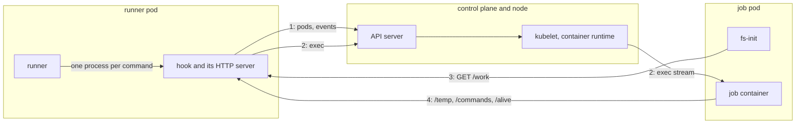
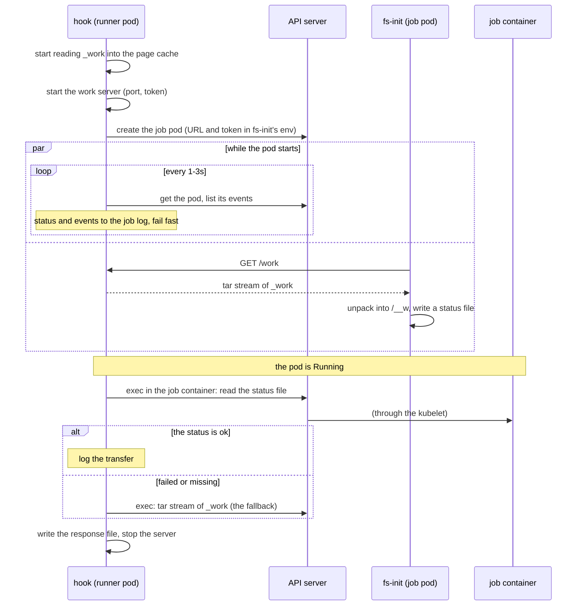
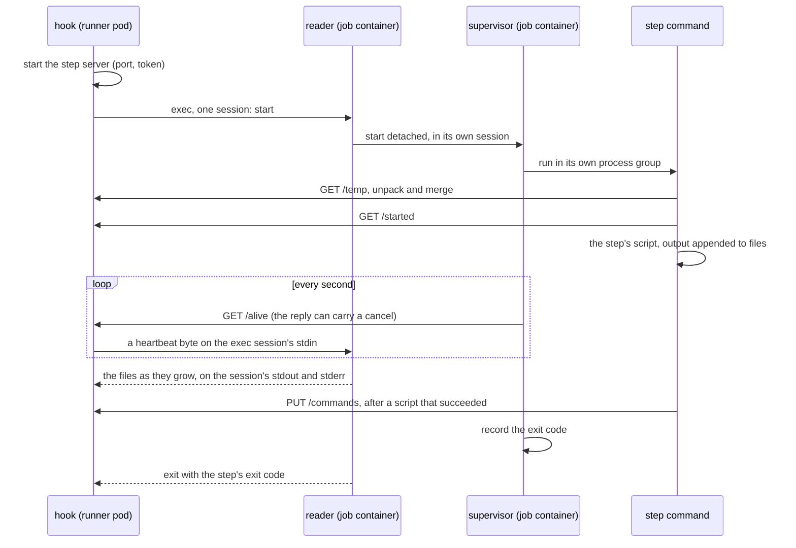

# kubernetes-novolume-hooks

Container hooks for the `kubernetes-novolume` container mode of
[actions-runner-controller](https://github.com/actions/actions-runner-controller) (ARC). The
bundle replaces `/home/runner/k8s-novolume/index.js` in the
[actions/runner](https://github.com/actions/runner) image, and runs each job in its own pod
with no volume shared between the runner pod and the job pod.

## Status

The author runs it in production CI since 1.0.0 (November 2026). Contributions are not being
accepted yet. Changes are recorded in [CHANGELOG.md](./CHANGELOG.md).

## Relationship to upstream

This is a fork of [actions/runner-container-hooks](https://github.com/actions/runner-container-hooks),
taken from upstream `main` at `d4731a4` (v0.8.1 plus 13 commits). It is a divergent fork, not a
mirror: it does not track upstream, and upstream fixes worth having are cherry-picked. Thanks to
the upstream maintainers and contributors, whose work this builds on.

This project is not affiliated with or endorsed by GitHub.

## What it is not

Only ARC's `kubernetes-novolume` mode is covered. This repository does not contain:

- the Docker hook (upstream's `packages/docker`);
- the volume-backed `kubernetes` mode, where the job pod mounts the runner's work volume;
- anything for ARC's `dind` mode, which uses no hooks;
- Windows support.

## Goals

- Faster job startup: less time between a runner picking up a job and its first step.
- Visible pod status in the job log while a job starts, so a slow or stuck job explains itself.
- Clear failures instead of silent retries.
- Steps that outlive a dropped connection to the job pod.

## What is different from upstream

Compared with upstream `main` at the fork point. [CHANGELOG.md](./CHANGELOG.md) has every
change; "[How it works](#how-it-works)" has the mechanics.

| Area                             | Upstream                                                                                                                                                                              | This fork                                                                                                                                                                                               |
| -------------------------------- | ------------------------------------------------------------------------------------------------------------------------------------------------------------------------------------- | ------------------------------------------------------------------------------------------------------------------------------------------------------------------------------------------------------- |
| Waiting for the job pod          | The poll delay doubles from 1s up to 20s, so a pod Running at 16s is noticed at 31s. The job log says nothing meanwhile.                                                              | Polls after 1s, then 15% longer each time up to 3s. The pod's status and events go to the job log, and an image that cannot be pulled fails the job after a grace period, not at the 10-minute timeout. |
| `_work` to the job pod           | After the pod is Running, a tar stream through the API server and the kubelet. Then one `chmod` and one `stat` process per file, and up to 15 silent retries of a hash comparison.    | `fs-init` downloads it from the hook over HTTP while the pod starts. The copy through the API server is the fallback, with `chmod` and `stat` once per batch of files and one comparison.               |
| The runner's externals (`/__e`)  | `fs-init` copies ~600 MB into an emptyDir for every job.                                                                                                                              | Mounted read-only from the runner image as an image volume. Nothing is copied.                                                                                                                          |
| Each step                        | Six exec sessions: a mkdir, the copy of `_temp` in, its check, the merge, the copy of the file commands back, its check.                                                              | One exec session. `_temp` and the file commands go over HTTP inside it.                                                                                                                                 |
| A dropped connection to the step | The step ends with its exec session. At the fork point the hook could even exit 0, so a step that may still have been running was marked passed (actions/runner-container-hooks#449). | The step runs detached from the session. The hook reconnects and resumes the output where it stopped.                                                                                                   |
| The job pod's size               | One pod template per scale set.                                                                                                                                                       | Optionally, each job asks for its memory, CPU, disk and architecture in its container's env, within limits the runner sets. One scale set serves every size.                                            |
| Failures                         | Copies are retried silently, and `tar`'s stderr is discarded. A failed step reports its exit code.                                                                                    | A copy that fails says why. When a step fails, what happened to the job pod is printed as errors: an OOM kill with the memory limit, an eviction, the pod's events.                                     |
| Non-root job containers, git     | A job container running as a uid other than 1001 cannot write the workspace. A later step's `git` fails with "dubious ownership" unless the workflow adds `safe.directory`.           | The workspace is group-writable through `fsGroup`, and `safe.directory=*` is set in the job container's environment.                                                                                    |

Upstream bugs fixed here (the changelog has the details): a pod template's `initContainers`
replaced `fs-init`, so every job failed (actions/runner-container-hooks#347);
`/github/workflow/event.json` was missing unless the job declared `container.volumes`
(actions/runner-container-hooks#330); two runners of a scale set with a long name got the
same job pod name; a copy from the job pod could return before the files were written.

Removed: the Docker hook, and the code left from the volume-backed mode.

## Performance

Times are the runner's "Initialize containers" step, which is the hook's `prepare_job`: from
the runner picking the job up to the job pod being ready for the first step. They are whole
seconds as GitHub reports them.

### Benchmark

Three synthetic jobs, five repetitions each, the median. Both builds ran on the same EKS
cluster with amd64 job pods; jobs whose pod waited for a new node are left out.

| Job                                                                       | Upstream `main` at `d4731a4` | This fork, 1.0.0 |
| ------------------------------------------------------------------------- | ---------------------------- | ---------------- |
| `small-actions`: a checkout and a few steps                               | 18s                          | 3s               |
| `large-actions`: the same, plus 183 MiB of actions in 11.5k files to copy | 84s                          | 7s               |
| `many-steps`: 20 trivial `run:` steps, no checkout                        | 32s                          | 4s               |

The fork's column is the last benchmark before 1.0.0 (`fb51869`; the commits after it do not
touch this path). From run to run its medians moved by 1-3s on the two small jobs, and
between 7s and 12s on `large-actions`. On arm64 job pods the same three jobs took 4s, 8s and
5s.

What each change bought, measured one change at a time:

| Change                                                          | Measured effect                                                                                                                              |
| --------------------------------------------------------------- | -------------------------------------------------------------------------------------------------------------------------------------------- |
| `chmod` and `stat` once per batch of files instead of per file  | `large-actions` -55s: the copy of 185 MiB took 12.6s instead of about 75s.                                                                   |
| Polling every 1-3s instead of doubling the delay up to 20s      | `small-actions` -8s, `large-actions` -9s, `many-steps` -20s.                                                                                 |
| Reading `_work` into the page cache before it is packed         | `large-actions` -9s: the transfer took 1.3-2.0s instead of 13-15s, after 2.7-3.1s of read-ahead that overlaps with the pod starting.         |
| `fs-init` downloads `_work` over HTTP                           | After the pod is Running, `prepare_job` needs 0.2s instead of 2.7s on `large-actions`, with the read-ahead in both.                          |
| Externals from an image volume instead of a 600 MB copy per job | Pods Running in 2-5s instead of 10-20s on nodes starting several job pods: the copies had the nodes' root volumes at their throughput limit. |
| `_temp` over HTTP in the step's own exec session                | The hook's own time per step 0.8s -> 0.3s. The steps of a 20-step job took 11.6-15.3s in total instead of 21.7-27.0s.                        |
| Detached steps (1.1.0)                                          | A cost: 0.4s per step instead of 0.3s.                                                                                                       |
| A pod watch instead of polling                                  | Not built. The polls noticed a Running pod 0.7s late (median of 60 jobs), which a watch could not improve by much.                           |

### In production

The fork runs a fleet of about 4.6k Linux jobs a week on EKS. These are the jobs of one
repository in it, over the two weeks before and the eight days after its workflows moved from
upstream's hook to the fork (November 2026, 6,737 jobs). Before is upstream v0.8.1 plus
actions/runner-container-hooks#316, a fix to the hash comparison after each copy; after is
this fork's 1.0.0.

| Jobs                                                         | Upstream, median | Upstream, p90 | Fork, median | Fork, p90 |
| ------------------------------------------------------------ | ---------------- | ------------- | ------------ | --------- |
| All (3,900 before, 2,837 after)                              | 47s              | 92s           | 12s          | 35s       |
| Test jobs on amd64, whose actions are 228 MiB in 14.7k files | 71s              | 125s          | 18s          | 83s       |
| The same test jobs on arm64                                  | 61s              | 126s          | 17s          | 32s       |
| Image manifest merges                                        | 24s              | 45s           | 5s           | 21s       |
| Every other job                                              | 23s              | 72s           | 5s           | 18s       |

On average the step took 52s per job before and 19s after.

Where the fork's remaining time goes, from the hook's timing lines in 208 of those job logs:

- **After the pod is Running, `prepare_job` takes 0.3s** (median; 0.9s at most), whatever the
  job.
- **The rest is the pod starting**: scheduling, the node, image pulls and `fs-init`. Outside
  the test jobs, a pod is Running 3.8s after it is created (median). The test jobs' pods
  take 16-19s, about 10s of which is `fs-init` downloading their 228 MiB of actions. That
  download waits on the runner pod reading and packing the files, not on the network or the
  job pod (0.2s of the 10s).
- **The slow tail is the pod, not the hook.** The amd64 test jobs' p90 of 83s is pods that
  took that long to reach Running, waiting for a node or an image.
- **Each step costs 0.4s** of hook time (median of 2,691 steps).
- **No job fell back** to the copy through the API server.

Queue time, from the job being created to a runner picking it up, went from 4s to 1s (median).
That is the scale sets' doing, not the hook's speed: with per-job sizing one scale set serves
every job size, so it can afford to keep one idle runner.

## How it works

### The runner, the hook and the job pod

In `kubernetes-novolume` mode the runner pod runs the Actions runner and no job containers.
For a job with a `container:`, the runner calls the hook, one bundled JavaScript file. Each
call is a new Node.js process that reads one command as JSON on stdin and exits:

| Command              | When the runner calls it                                                                                                    | What the hook does                                                                                    |
| -------------------- | --------------------------------------------------------------------------------------------------------------------------- | ----------------------------------------------------------------------------------------------------- |
| `prepare_job`        | Once, as the "Initialize containers" step.                                                                                  | Creates the job pod, waits for it to run, and gets the runner's `_work` directory into it.            |
| `run_script_step`    | For every step that runs in the job container: a `run:` step, or a JavaScript action (the runner starts both the same way). | Syncs `_temp` to the job pod, runs the step's script there, and brings the step's file commands back. |
| `run_container_step` | For a container action (`uses: docker://...`).                                                                              | Runs it in a pod of its own, copying the workspace there and back.                                    |
| `cleanup_job`        | Once, at the end of the job.                                                                                                | Deletes the job's pods and Secrets.                                                                   |

The hook keeps nothing in memory between calls. What a later call needs (the job pod's name,
whether steps can use HTTP) goes into `prepare_job`'s response file, which the runner hands
back as `state`.

The job pod is named `<runner pod>-workflow` and has:

- an init container, `fs-init`, running the runner image;
- the `job` container, running the workflow's image with `tail -f /dev/null` as its command,
  so it stays up for steps to be exec'd into, and the job's service containers;
- three volumes: `/__w` (the work directory, an emptyDir), `/github` (an emptyDir) and `/__e`
  (the runner's externals: its Node.js builds, which run JavaScript actions and the hook's
  own client in the job container).

No volume is shared with the runner pod, so the job pod can be scheduled on any node. The
price is that files have to be copied: `_work` once (the downloaded actions and the empty
workspace; the repository itself is checked out inside the job pod), and `_temp` around
every step (the step's script on the way in, `GITHUB_OUTPUT`, `GITHUB_ENV` and the other file
commands on the way back). Upstream sends all of it through the Kubernetes API server. Most
of this fork is about doing that directly, and about what else can go wrong on the way.

### Who connects to whom

Four routes, two in each direction:



| Route | From → to                              | Through                                            | Carries                                                                                                                                             |
| ----- | -------------------------------------- | -------------------------------------------------- | --------------------------------------------------------------------------------------------------------------------------------------------------- |
| 1     | hook → API server                      | The Kubernetes API.                                | Creating, reading and deleting pods and Secrets; the pod's events.                                                                                  |
| 2     | hook → job container                   | An exec session: API server, kubelet, the runtime. | Starting each step and reading its output; a heartbeat byte a second on the session's stdin; the hook's cancel; every copy when HTTP is not usable. |
| 3     | `fs-init` → hook's work server         | The pod network, directly to the runner pod's IP.  | `GET /work`: `_work` as a tar stream. The server lives for the length of `prepare_job`.                                                             |
| 4     | job container → hook's per-step server | The pod network, directly.                         | `GET /temp`, `GET /started`, `PUT /commands` and the liveness poll `GET /alive`. The server lives for the length of one step.                       |

Routes 3 and 4 are the fork's. They are the primary path for file transfers, with route 2 as
the fallback (see "[Fallbacks](#fallbacks)"), and route 4 also tells the job pod whether the
hook is still there.

- **They need the job pod to reach the runner pod** on an ephemeral port. Where a
  NetworkPolicy or a firewall forbids that, set `HOOK_WORK_TRANSFER=exec`, or every job waits
  for a connect timeout before it falls back.
- **The runner pod's address** comes from `ACTIONS_RUNNER_POD_IP` (set it from
  `status.podIP`), else from the first non-internal IPv4 address in the container.
- **Plain HTTP, authorized by a one-time token** of 32 random bytes per server. The work
  server's token is in the job pod's spec, readable by whoever can read pods in the
  namespace, and is worth nothing once `prepare_job` ends. The step server's token is in the
  exec session's command line. It grants only what the job already has: reading its own
  `_temp` and writing its own file commands (entries outside `_runner_file_commands/` are
  ignored).

### `prepare_job`



1. **The job pod's template.** The runner's fixed template
   (`ACTIONS_RUNNER_CONTAINER_HOOK_TEMPLATE`), or one built from the job's `HOOK_JOB_*`
   values (see "[Per-job sizing](#per-job-sizing)"). A sizing error fails the job here,
   before a pod exists. A template's `initContainers` are added after `fs-init`.
2. **Read-ahead.** The actions the runner has just downloaded are often not in the page
   cache yet, and packing them reads one file at a time from the node's disk. 32 parallel
   readers (`cat` to `/dev/null`) warm the cache while the pod is created and starts. It
   never fails the job, and stops when the copy is done.
3. **The step client** is written into `_work/_custom_hook/`, so it reaches the job pod with
   `_work`.
4. **`fs-init`** creates the directories group-writable, links `/github/workflow` and
   `/github/home` into `_temp`, and downloads `_work` with `curl | tar`. It records the
   result in `/github/.hook-work` and always exits 0: a failed download must not fail the
   pod, because the hook can still copy.
5. **Externals.** `/__e` is an image volume of the runner image (`HOOK_EXTERNALS=image`),
   mounted read-only at its `externals` directory. With `HOOK_EXTERNALS=copy`, `fs-init`
   moves them into an emptyDir as upstream does.
6. **Waiting.** The hook polls the pod and prints what it sees (next section).
7. **After Running**, one exec reads the status file. If `fs-init` downloaded `_work`, the
   hook only logs the numbers. If not, it warns and copies `_work` over exec.

### Pod status and fail fast

While the pod starts, the hook reads it after 1s, then 15% later each time up to every 3s,
and lists its events every 2s. The job log gets every event once (again when an aggregated
event repeats), the pod's phase, conditions and container states whenever they change, a
line every 5 quiet seconds, and once Running, when each condition turned true and each
container started. Kubernetes' reasons and messages are passed through as they are, so a job
waiting for a node shows the scheduler's and the autoscaler's events.

Fail fast: a container that waits in `ErrImagePull`, `ImagePullBackOff` or
`CreateContainerConfigError` for longer than `HOOK_FAIL_FAST_SECONDS`, or in
`InvalidImageName` at all, fails `prepare_job` with the kubelet's message. Otherwise the wait
ends at `ACTIONS_RUNNER_PREPARE_JOB_TIMEOUT_SECONDS`, counted in wall-clock time.

Listing events needs the `events` rule (see "[Permissions](#permissions)"). Without it the
hook warns once and shows the pod's status only.

### Steps



One exec session per step, where upstream uses six. The session's command runs the step
client, `/__w/_custom_hook/step-client.js`, with the runner's own Node.js from `/__e` (the
Alpine build in a musl image):

- **`start`** stops what an interrupted earlier step left running, starts the supervisor in
  its own session, and then reads the step's output files to its stdout and stderr, which is
  what the hook sees.
- **The supervisor** takes a lock, runs the step's command in its own process group with
  stdout and stderr appended to two files, and records the exit code in a third.
- **The step's command** downloads `_temp` from the hook and merges it, runs the step's
  script as upstream does (`sh -e`), and after a script that exits 0 uploads
  `_runner_file_commands`.

Copies over HTTP are not compared file by file afterwards: `tar`'s exit status and the HTTP
status are the check.

### Steps that survive a dropped connection

Every step's output and exit code come back to the runner over an exec session through the
Kubernetes API server and the kubelet. Upstream's hook runs the step inside that session,
so when the connection drops (a restarted or replaced API server instance, as happens during
managed control-plane maintenance), the container runtime kills the step with it.

Here the step runs detached in the job pod, as described above, with its output and exit
code in files under `/__w/_custom_hook/steps/`. The exec session only prints the files as
they grow. When it drops, the hook logs a `[custom-hook] lost the connection to the step`
line and reconnects with backoff (after 1s, 2s and 4s, then every 5s) for up to
`HOOK_STEP_RECONNECT_SECONDS`, resuming the output from the bytes it has received, so nothing
is printed twice or lost. A `[custom-hook] reconnected to the step` line says how long it
took. A later drop in the same step gets the full time again. In the normal case a step still
costs one exec session.

- **Never twice.** The supervisor takes a lock in the step's directory before it runs the
  step, so a launch the hook has to repeat cannot run it a second time.
- **Cancel and `timeout-minutes`.** The runner's SIGINT goes to the step's process group, so
  the step can clean up as on a VM runner. A group still running 6s later, or the runner's
  SIGTERM, gets SIGKILL. The signal goes both through an exec session and through the
  supervisor's next poll of the hook, which does not need the API server; the step gets the
  SIGINT once, whichever arrives first. Once a cancelled step has ended, whatever it left
  running in its process group is killed too.
- **A hook that is gone.** The supervisor polls the hook's per-step server every second, pod
  to pod, and the hook writes a byte a second to the stdin of the exec session that reads
  the step's output. When `HOOK_STEP_ORPHAN_SECONDS` polls in a row have failed and no byte
  has arrived for 5s, the hook is gone, and the supervisor stops the step. One of the two
  alone is not enough: the polls fail during a pod network blip, and the exec session is
  gone during an API server restart. That the session's process still runs in the job pod
  proves nothing: a hook that dies leaves it behind.
- **No overlap.** Before a step starts, anything an earlier step left running without a
  recorded exit code (its hook was killed) is killed. Processes a finished step started in
  the background on purpose (`nohup server &`) are left alone, as on a VM runner.
- **A reconnect that fails.** When the hook cannot reconnect in time, it has the supervisor
  kill the step before it reports the failure, so the step does not run on unseen. The order
  to kill goes in the reply to the supervisor's poll, so it does not need the connection
  that could not be restored.
- **A dead supervisor or reader** (a step that runs `pkill -9 node`). Without its supervisor
  the step fails within a second or two, instead of at `timeout-minutes`. When only the
  process reading the output was killed, the hook sees that the step has recorded no exit
  code and reads on; plain `pkill node` (SIGTERM) reaches neither.
- **Too much output.** A step that has written more than `HOOK_STEP_OUTPUT_LIMIT_MB` is
  stopped, with a `[custom-hook]` line saying so, before it fills the node's disk.
- **A job container that is gone** (OOM-killed) fails the step, and the steps after it,
  with a plain message instead of retrying.

The two liveness routes, and what each combination means to the supervisor:

| Heartbeat on the exec session (hook → API server → kubelet → job pod) | Liveness poll (job pod → runner pod)       | What happened                                 | The step                            |
| --------------------------------------------------------------------- | ------------------------------------------ | --------------------------------------------- | ----------------------------------- |
| arriving                                                              | answered                                   | Nothing.                                      | Runs.                               |
| silent for 5s                                                         | answered                                   | The exec session dropped; the hook is alive.  | Runs. The hook reconnects.          |
| arriving                                                              | failing                                    | The pod network between the two pods is down. | Runs.                               |
| silent for 5s                                                         | `HOOK_STEP_ORPHAN_SECONDS` in a row failed | The hook or the runner pod is gone.           | Gets SIGTERM, and SIGKILL 3s later. |

### Fallbacks

HTTP between the two pods comes first, and the copy through the API server stays in the code
as the fallback. Each fallback is one line in the job log, so a job that is slower than its
neighbours says why.

| What                             | First choice                              | Fallback                                                                                            | When the fallback is used                                                                                                                                               |
| -------------------------------- | ----------------------------------------- | --------------------------------------------------------------------------------------------------- | ----------------------------------------------------------------------------------------------------------------------------------------------------------------------- |
| `_work` to the job pod           | `fs-init` downloads it (route 3).         | The hook copies it over exec once the pod is Running (route 2), as upstream.                        | `HOOK_WORK_TRANSFER=exec`; the runner pod's IP is unknown; the server cannot start; `fs-init` reports a failed download, or nothing. A warning, except for the setting. |
| `_temp` around a step            | HTTP inside the step's session (route 4). | The six exec sessions of upstream, for this step and the rest of the job. Those steps run attached. | The step could not be started over HTTP: a warning. Or the runner has no Node.js for the job container (a musl image on arm64): an info line.                           |
| The file commands back           | `PUT /commands`.                          | A copy from the job pod over exec.                                                                  | The upload did not arrive: a warning.                                                                                                                                   |
| The step's output                | The exec session that started the step.   | A new exec session that resumes at the byte offsets received.                                       | The session dropped: two info lines.                                                                                                                                    |
| The pod's events while it starts | Listed every 2s.                          | The pod's status only.                                                                              | The runner's Role has no `events` rule: a warning.                                                                                                                      |
| Externals                        | An image volume.                          | None by itself. `HOOK_EXTERNALS=copy` restores upstream's copy.                                     | Set it where image volumes are not available.                                                                                                                           |

A step is retried on the exec path only when it certainly did not run: the session ended with
an exit code before the hook's server saw the step's script start. After a lost connection
the step may still be running, so it fails instead (and is killed first), and a cancelled
step is not retried either.

### Files in the job pod

| Path                               | What                                                                                                                                                              |
| ---------------------------------- | ----------------------------------------------------------------------------------------------------------------------------------------------------------------- |
| `/__w`                             | The runner's `_work`: `_actions`, `_temp`, the workspace.                                                                                                         |
| `/__w/_custom_hook/step-client.js` | The step client, written by `prepare_job`.                                                                                                                        |
| `/__w/_custom_hook/steps/<id>/`    | One directory per step: `stdout`, `stderr`, `exit`, the lock files `pid`, `pgid` and `follower`, and `interrupted`. The next step's start removes a finished one. |
| `/github/.hook-work`               | `fs-init`'s report on the download: `ok <milliseconds>` or `failed: ...`.                                                                                         |
| `/github/workflow`, `/github/home` | Links into `/__w/_temp`, so `GITHUB_EVENT_PATH` is there and current.                                                                                             |
| `/__e`                             | The runner's externals, read-only when they are an image volume.                                                                                                  |

On the runner, `_work/_custom_hook/step-http-off` records that a job's steps take the exec
path, so later steps do not try HTTP again.

### Container steps and cleanup

`run_container_step` works as upstream: a pod of its own for the action's image, all of
`/__w` copied from the job pod to the runner and on to the step pod over exec, and the
action run attached in one exec session. A dropped connection fails it. `cleanup_job`
deletes the pods and Secrets that carry the runner's label.

### Source map

Everything is in `packages/k8s/src`; `packages/hooklib` is upstream's types for the runner's
commands.

| File                                                  | What is in it                                                                            |
| ----------------------------------------------------- | ---------------------------------------------------------------------------------------- |
| `index.ts`                                            | The entry point: the permission check and the command switch.                            |
| `hooks/prepare-job.ts`                                | `prepare_job`.                                                                           |
| `hooks/run-script-step.ts`                            | `run_script_step`: the HTTP path, its settings, and the exec path.                       |
| `hooks/run-container-step.ts`, `hooks/cleanup-job.ts` | The other two commands.                                                                  |
| `k8s/index.ts`                                        | The Kubernetes calls: the job pod, exec sessions, the exec copies, the wait for the pod. |
| `k8s/work-transfer.ts`, `k8s/read-ahead.ts`           | The work server, `fs-init`'s download script, the read-ahead.                            |
| `k8s/step-transfer.ts`                                | The per-step server and the client's `_temp` download and upload.                        |
| `k8s/step-supervisor.ts`                              | The client's detached-step modes (`start`, `supervise`, `follow`, `signal`, `status`).   |
| `k8s/step-follow.ts`                                  | The hook's side of a detached step: the reconnect loop and the cancel.                   |
| `k8s/pod-status.ts`, `k8s/poll.ts`                    | The status and event lines, fail fast, the poll schedule.                                |
| `k8s/job-size.ts`                                     | Per-job sizing.                                                                          |
| `k8s/externals.ts`, `k8s/git-safe-directory.ts`       | The image volume, and git's `safe.directory`.                                            |

The step client is the functions in `step-transfer.ts` and `step-supervisor.ts` written out
as source (`Function.toString()`), so it has no imports and no build step of its own.

## Usage

Build a runner image with the bundle from this repository's `Dockerfile`, which drops it over
the stock hook in a pinned `actions-runner` image (its header has the multi-arch commands):

```sh
podman build -t <registry>/<repository>:<tag> .
```

Or take the bundle alone and copy it over `/home/runner/k8s-novolume/index.js` in your own
image. The `Dockerfile`'s builder stage produces it as `packages/k8s/dist/index.js`, and
`scripts/container-npm.sh` runs the same npm commands in that builder image, so nothing is
installed on the host.

[`examples/arc`](./examples/arc) is a whole setup, adapted from the author's production scale
set on EKS with Karpenter:

| File                | What it is                                                                                                                                                  |
| ------------------- | ----------------------------------------------------------------------------------------------------------------------------------------------------------- |
| `Dockerfile`        | A runner image for a repository of your own: it builds the bundle from a pinned commit of this project instead of from a checkout.                          |
| `values.yaml`       | Values for ARC's `gha-runner-scale-set` chart: one scale set with a warm runner that serves every job size.                                                 |
| `job-profiles.yaml` | The ConfigMap of profiles for per-job sizing: `standard` (the job runs in a user namespace) and `podman` (privileged, for image builds).                    |
| `job-started.sh`    | A runner job-started hook that marks a runner pod `karpenter.sh/do-not-disrupt` once it has a job. Not part of the container hooks; a warm runner wants it. |
| `workflow.yaml`     | A workflow whose jobs ask for their pod's size.                                                                                                             |

The least a scale set needs for the hook, without sizing:

```yaml
containerMode:
  type: kubernetes-novolume
  kubernetesModeAdditionalRoleRules:
    - apiGroups: ['']
      resources: ['events']
      verbs: ['get', 'list']
template:
  spec:
    containers:
      - name: runner
        image: <registry>/<repository>:<tag>
        command: ['/home/runner/run.sh']
        env:
          - name: ACTIONS_RUNNER_CONTAINER_HOOKS
            value: /home/runner/k8s-novolume/index.js
          - name: ACTIONS_RUNNER_POD_NAME
            valueFrom:
              fieldRef:
                fieldPath: metadata.name
          - name: ACTIONS_RUNNER_REQUIRE_JOB_CONTAINER
            value: 'true'
          # The image fs-init runs and the externals volume mounts: the runner's own.
          - name: ACTIONS_RUNNER_IMAGE
            value: <registry>/<repository>:<tag>
          # The address the job pod downloads from.
          - name: ACTIONS_RUNNER_POD_IP
            valueFrom:
              fieldRef:
                fieldPath: status.podIP
```

## Configuration

The hooks are configured through environment variables. Each one is read from one or two
places:

- **job**: the job container's env, `container.env` in the workflow;
- **runner**: the runner container's env, set in the scale set's pod template;
- **step**: the step's env (`env:` on the step, the job or the workflow).

Where both are listed, the job's value wins over the runner's, so the runner sets a default
for the scale set and a workflow can override it. An empty value counts as unset.

### Settings

| Variable                           | Read from   | Default | Values and effect                                                                                                                                                                                                                                                                          |
| ---------------------------------- | ----------- | ------- | ------------------------------------------------------------------------------------------------------------------------------------------------------------------------------------------------------------------------------------------------------------------------------------------ |
| `HOOK_WORK_TRANSFER`               | job, runner | `http`  | `http`: the job pod downloads `_work` from the hook, and each step syncs `_temp` the same way. `exec`: copy through the Kubernetes API, as upstream does; use it where the job pod cannot reach the runner pod (a NetworkPolicy, a firewall).                                              |
| `HOOK_EXTERNALS`                   | job, runner | `image` | `image`: mount the runner's externals (`/__e`) read-only from the runner image as an image volume. Needs Kubernetes 1.35+, or the `ImageVolume` feature gate on 1.33-1.34, and a runtime that supports image volumes (e.g. containerd 2.1+). `copy`: `fs-init` copies them, as upstream.   |
| `HOOK_GIT_SAFE_DIRECTORY`          | job, runner | `true`  | `true`: add `safe.directory=*` to the job container's git config through `GIT_CONFIG_COUNT`/`GIT_CONFIG_KEY_<n>`/`GIT_CONFIG_VALUE_<n>`, after any entries the workflow sets. `false`: leave git's config alone.                                                                           |
| `HOOK_FAIL_FAST`                   | job, runner | `true`  | `true`: fail `prepare_job` with the kubelet's message when a job pod container stays in `ErrImagePull`, `ImagePullBackOff` or `CreateContainerConfigError` past the grace period, or hits `InvalidImageName`. `false`: wait for the prepare-job timeout, as upstream.                      |
| `HOOK_FAIL_FAST_SECONDS`           | job, runner | `60`    | The grace period, in whole seconds. It must be below `ACTIONS_RUNNER_PREPARE_JOB_TIMEOUT_SECONDS`, or that timeout comes first.                                                                                                                                                            |
| `HOOK_STEP_RECONNECT_SECONDS`      | runner      | `60`    | How long the hook keeps reconnecting to a step after its exec session drops (see "Steps that survive a dropped connection"). The step keeps running meanwhile; past this, it is stopped and fails. Each drop gets the full time.                                                           |
| `HOOK_STEP_ORPHAN_SECONDS`         | runner      | `15`    | How long a step runs on after its hook is gone (the runner pod died, or the hook was killed): this many seconds of failed liveness polls, with nothing from the hook on the exec session that reads the step's output either. Then the step's processes get SIGTERM, and SIGKILL 3s later. |
| `HOOK_STEP_OUTPUT_LIMIT_MB`        | runner      | `2048`  | How much output (stdout plus stderr, in MiB) a step may write before it is stopped the same way. The output waits in files in the job pod until the hook has read it, so nothing slows down a step that writes faster than that.                                                           |
| `HOOK_TEST_DROP_STEP_EXEC_SECONDS` | step        | none    | Testing only: cut each of the step's exec sessions after this many seconds, as an API server restart would, so the reconnect can be tested on demand (a step longer than twice this is cut more than once). Ignored unless the runner sets `HOOK_TEST_ALLOW_STEP_EXEC_DROP`.               |
| `HOOK_TEST_ALLOW_STEP_EXEC_DROP`   | runner      | `false` | `true`: steps may use `HOOK_TEST_DROP_STEP_EXEC_SECONDS`. For a test scale set only: on any other, a workflow could cut its own steps.                                                                                                                                                     |

A value that is not one of the listed ones is a warning in the job log, and the default is
used. The job log's `[custom-hook]` lines say which value each setting took and where it came
from.

### Per-job sizing

A runner with `HOOK_JOB_PROFILE_DIR` set builds each job pod's template from a profile and the
size the job asks for, so one scale set can serve jobs of every size. A job that sets none of
the job variables below gets the runner's fixed template (`ACTIONS_RUNNER_CONTAINER_HOOK_TEMPLATE`)
as upstream; if the runner has no fixed template, the job fails and names the variables to set. A
job that sets them on a runner without `HOOK_JOB_PROFILE_DIR` fails. Values are parsed strictly
and never rounded, and a malformed, missing or over-limit value fails the job before a pod is
created, naming every problem at once.

| Variable               | Read from | Default             | Values and effect                                                                                                                                                                                         |
| ---------------------- | --------- | ------------------- | --------------------------------------------------------------------------------------------------------------------------------------------------------------------------------------------------------- |
| `HOOK_JOB_MEMORY`      | job       | required            | The job container's memory request and limit, in `Mi` or `Gi` (`512Mi`, `7Gi`, `1.5Gi`).                                                                                                                  |
| `HOOK_JOB_CPU`         | job       | required            | The job container's CPU request, in cores (`2`, `0.5`) or millicores (`500m`).                                                                                                                            |
| `HOOK_JOB_DISK`        | job       | the profile's       | The job container's `ephemeral-storage` request, in `Mi` or `Gi`. Refused unless the runner sets `HOOK_JOB_MAX_DISK`.                                                                                     |
| `HOOK_JOB_ARCH`        | job       | `amd64`             | `amd64` or `arm64`: the job pod's `kubernetes.io/arch` node selector. `any`: no selector, for multi-arch job images; the job log says which architecture the pod ran on.                                  |
| `HOOK_JOB_PROFILE`     | job       | `standard`          | The profile to build the pod from; one of `HOOK_JOB_PROFILES`.                                                                                                                                            |
| `HOOK_JOB_PROFILE_DIR` | runner    | none (sizing off)   | The directory holding the profiles, one pod template per profile named `profile-<name>.yaml`, in the same format as `ACTIONS_RUNNER_CONTAINER_HOOK_TEMPLATE` (e.g. a mounted ConfigMap). Turns sizing on. |
| `HOOK_JOB_PROFILES`    | runner    | `standard`          | The profiles jobs may ask for, comma-separated.                                                                                                                                                           |
| `HOOK_JOB_MAX_MEMORY`  | runner    | required for sizing | The most memory a job may ask for.                                                                                                                                                                        |
| `HOOK_JOB_MAX_CPU`     | runner    | required for sizing | The most CPU a job may ask for.                                                                                                                                                                           |
| `HOOK_JOB_MAX_DISK`    | runner    | none                | The most disk a job may ask for. Without it, jobs cannot set `HOOK_JOB_DISK`.                                                                                                                             |
| `HOOK_JOB_CPU_LIMIT`   | runner    | none (no CPU limit) | The job container's CPU limit, the same for every job. It must be at least `HOOK_JOB_MAX_CPU`.                                                                                                            |

The hook owns the job container's memory and CPU: the profile's values for them are replaced.
The pod is annotated with the requested values (`custom-hook/memory`, `cpu`, `disk`, `arch`,
`profile`), so usage can be compared with requests.

### Runner variables

Set on the runner container. ARC sets `ACTIONS_RUNNER_POD_NAME`, and the runner sets
`RUNNER_WORKSPACE` and `RUNNER_TEMP`; the others are yours to set.

| Variable                                     | Default                                 | Effect                                                                                                                                                                                                    |
| -------------------------------------------- | --------------------------------------- | --------------------------------------------------------------------------------------------------------------------------------------------------------------------------------------------------------- |
| `ACTIONS_RUNNER_POD_IP`                      | the first non-internal IPv4 address     | The address the job pod downloads from (`HOOK_WORK_TRANSFER=http`). Set it from the downward API (`fieldRef: status.podIP`). If no address is found, the hook warns and copies over exec.                 |
| `ACTIONS_RUNNER_IMAGE`                       | `ghcr.io/actions/actions-runner:latest` | The image `fs-init` runs, and the image the externals volume mounts (`HOOK_EXTERNALS=image`). Set it to the runner container's own image, so the job pod's externals (`/__e`) match the runner's version. |
| `ACTIONS_RUNNER_POD_NAME`                    | required                                | The runner pod's name. Job pod, step pod and Secret names derive from it; a name too long for Kubernetes loses characters from the middle and keeps its unique tail.                                      |
| `ACTIONS_RUNNER_CONTAINER_HOOK_TEMPLATE`     | none                                    | A fixed pod template for the job pod, as upstream. Template `initContainers` run after the hook's `fs-init`.                                                                                              |
| `ACTIONS_RUNNER_PREPARE_JOB_TIMEOUT_SECONDS` | `600`                                   | How long the job pod has to reach Running.                                                                                                                                                                |
| `ACTIONS_RUNNER_KUBERNETES_NAMESPACE`        | the service account's namespace         | The namespace job pods are created in.                                                                                                                                                                    |
| `ACTIONS_RUNNER_HEARTBEAT_PERIOD_MS`         | `5000`                                  | The ping period on exec sessions.                                                                                                                                                                         |
| `ACTIONS_RUNNER_HEARTBEAT_DEADLINE_MS`       | 12 periods plus 1s                      | How long an exec session may go without a pong before it fails.                                                                                                                                           |

`HOOK_WORK_URL`, `HOOK_WORK_TOKEN`, `HOOK_STEP_URL`, `HOOK_STEP_TOKEN`, `HOOK_STEP_UNPACK`,
`HOOK_STEP_MERGE`, `HOOK_STEP_PACK` and `HOOK_RUN_*` are set by the hook for `fs-init` and
its step client. They are internal, not settings.

### The hook's lines in the job log

Everything the hook prints starts with `[custom-hook]`. "Initialize containers" of a job
whose pod started on a node that had the images, abridged:

```text
[custom-hook] job pod sized from the job: memory 5Gi, cpu 3 (limit 20), disk from profile, arch amd64, profile standard
[custom-hook] work transfer http (default), externals image (default), git safe.directory on (default)
[custom-hook] job pod example-runner-tjhp9-workflow created in 0.0s
[custom-hook] fail fast on (default), grace period 60s (default)
[custom-hook] 0s   Normal Scheduled (default-scheduler): Successfully assigned runners/example-runner-tjhp9-workflow to node-1
[custom-hook] 0s   status: Pending; PodScheduled=True
[custom-hook] 1s   Normal Started (kubelet): Container started
[custom-hook] 2s   status: Pending; ...; fs-init terminated Completed, exit 0, job waiting PodInitializing
[custom-hook] 4s   status: Running; ...; fs-init terminated Completed, exit 0, job running
[custom-hook] pod Running after 4s: PodScheduled +0s, PodReadyToStartContainers +1s, fs-init +1s..+1s, Initialized +2s, job +2s, Ready +3s, ContainersReady +3s
[custom-hook] job pod Running 3.7s after create
[custom-hook] copy _work to job pod over HTTP: 11 files, 37.7 KiB served in 0.0s (0.0s of it waiting on the job pod); fs-init download and unpack 0.0s
[custom-hook] read-ahead of _work finished in 0.0s
[custom-hook] prepare_job done in 4.0s
```

After each step, where "overhead" is the step's total time less its script's:

```text
[custom-hook] sync _temp over HTTP: 18 files, 10.4 KiB down in 0.0s; 14 files, 211 B up in 0.0s
[custom-hook] run_script_step overhead 0.4s (script 0.0s, total 0.5s)
```

Around a dropped connection, and after a step that was OOM-killed (as errors):

```text
[custom-hook] lost the connection to the step (command sh in example-runner-fg79t-workflow: the exec stream closed before the command reported an exit status); the step keeps running, reconnecting for up to 60.0s
[custom-hook] reconnected to the step after 1.2s; its output resumes where it stopped
[custom-hook] job terminated OOMKilled, exit 137 (memory limit 5Gi)
```

Warnings are the fallbacks (see "[Fallbacks](#fallbacks)"), a setting with a value that is
not allowed, and a copy whose files do not match afterwards. The wording of these lines is
not an interface and changes between releases.

## Permissions

The runner's service account needs upstream's rules, which the hook checks before every
command, plus `events`:

```yaml
- apiGroups: ['']
  resources: ['pods']
  verbs: ['get', 'list', 'create', 'delete']
- apiGroups: ['']
  resources: ['pods/exec']
  verbs: ['get', 'create']
- apiGroups: ['']
  resources: ['secrets']
  verbs: ['get', 'list', 'create', 'delete']
- apiGroups: ['']
  resources: ['events']
  verbs: ['get', 'list']
```

With ARC, add the `events` rule through `containerMode.kubernetesModeAdditionalRoleRules`.
Without it, the job log has a warning and shows only the pod's status while it starts, not
the scheduler's, Karpenter's or the kubelet's events.

The hooks never patch pods. A runner job-started hook (`ACTIONS_RUNNER_HOOK_JOB_STARTED`)
that annotates its own pod, for example so Karpenter does not disrupt a long-lived runner
while it runs a job, needs `patch` on `pods` as well.

## Compatibility

Tested, and run in production, with:

- actions/runner 2.338.2, the image the `Dockerfile` builds on. The runner runs the hook
  with its own `node24`; the bundle needs Node.js 22 or later.
- ARC's `gha-runner-scale-set` chart 0.15.1.
- Kubernetes 1.35 on EKS, with containerd 2.2 on Bottlerocket nodes, amd64 and arm64.

What it needs from the cluster and the images:

- **Image volumes** for `HOOK_EXTERNALS=image`, the default: Kubernetes 1.35+, or the
  `ImageVolume` feature gate on 1.33-1.34, and a runtime that supports them. Otherwise set
  `HOOK_EXTERNALS=copy`.
- **The job pod must reach the runner pod** for the HTTP transfers. Otherwise set
  `HOOK_WORK_TRANSFER=exec`.
- **`curl` and GNU `tar` in the `fs-init` image**, which is the runner image
  (`ACTIONS_RUNNER_IMAGE`). The stock `actions-runner` image has both.
- **The usual shell tools in the job image**: `sh`, `tail`, `tar`, `find`, `cp` and `chmod`,
  and `stat` for the copies over exec. The busybox ones do: Alpine images are in the test
  suite.
- **cgroup v2 nodes** for the report of an OOM kill after a failed step.

## Versioning

[Semantic versioning](https://semver.org/). A major version is a change that would surprise
someone whose setup works: a renamed or removed `HOOK_*` variable, a new required Role rule
or cluster feature, or a default whose new value changes what ordinary jobs do. A retuned
default that almost no job ever reaches (a timeout, a limit) is not one: it ships in a minor
version and is listed under "Changed" in the changelog. The wording of the job log's lines
is not an interface.

## Known limitations

- JavaScript actions in Alpine (musl) job containers need both the job pod and the runner pod
  on amd64. The runner ships Node.js for musl on x64 only, and refuses such actions when it
  runs on arm64 itself, whatever the job pod's architecture. `run:` steps work in them on
  both architectures (on arm64 the hook syncs `_temp` over exec, with an info line), and
  glibc job images have no such limit.
- Local actions (`uses: ./path`) fail with "Can't find 'action.yml'": the checkout happens in
  the job pod, and the runner reads the action from its own workspace. Reference the action
  through its repository instead.
- Steps that do not sync `_temp` over HTTP (`HOOK_WORK_TRANSFER=exec`, or a job image the
  runner has no Node.js for) run attached, as upstream: a dropped exec session fails them.
  So do container-action steps (`uses: docker://...`).
- A step's stdout and stderr are read from two files, so lines written to both within a
  fraction of a second appear in the job log grouped by stream rather than in the order
  they were written: a `set -x` trace can follow the output of its commands. Each line is
  whole.
- As upstream: every job needs a job container, container actions cannot be built from a
  Dockerfile, and `container.options` is not supported.

## Disclaimer

This project is largely vibe coded: it is written with an AI coding agent. The author runs it in
their own CI, so it is exercised for real, but it comes with no warranty or guarantee of any
kind. Use it at your own risk, as the MIT license also says.

## License

MIT, see [LICENSE](./LICENSE).
